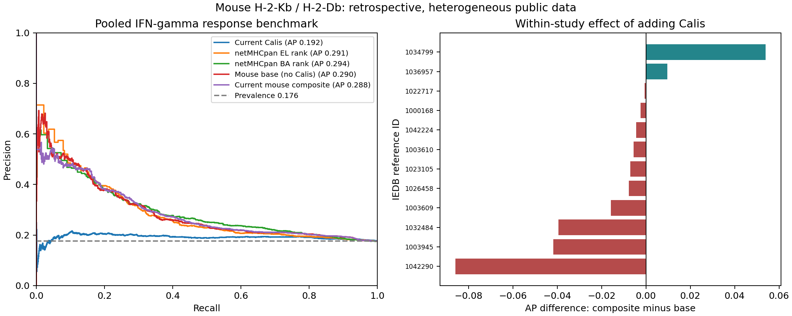

# 老鼠 immunogenicity：公開資料盤點與基準比較

分析日期：2026-10-09（Asia/Taipei）。分支：`feature/mouse-immunogenicity`。
本報告針對目前系統的 H-2-Kb／H-2-Db 排序能力；不代表所有老鼠品系、
CD4 T-cell、腫瘤 neoantigen，或疫苗療效。這次沒有進行動物實驗，也沒有訓練新模型。

## 判斷與下一步

**值得啟動老鼠專用模型的可行性訓練，但目前不應直接把整份資料拿去訓練、
宣稱通過獨立驗證，或替換正式系統。** 優先工作是釐清實驗情境與獨立驗證資料。

目前的 Calis 實作單獨排序能力有限；把它加入平台的呈現／結合基礎分數後，
AP 並沒有明確改善。這支持探索更適合老鼠的特徵或模型，但不能證明任何新模型
一定較好，也不能把有限差異解讀為現行 Calis 在所有情境下無用。

建議開發順序：

1. 先限定使用情境：感染後反應、peptide vaccination 或腫瘤 neoantigen。
   目前資料偏感染抗原；不能直接作為腫瘤專用訓練集。
2. 依 `studies.csv` 回查主要研究，標記 priming antigen、restimulation、
   細胞轉移／TCR 背景、MHC restriction 證據及真正測試的候選集合。
   特別區分「能誘發反應」與「既有 T cells 對另一條 peptide 的交叉反應」。
3. 先鎖定按研究／實驗／序列家族隔離的測試集，對訓練與測試交界的相近序列
   做排除；保留每個 allele 的陽性與陰性資料。不可為求平衡而任意拆散同源配對。
4. 再比較簡單 logistic regression／gradient boosting，以及現有 netMHCpan
   基準；先評估加入序列特徵是否有額外價值，再考慮更複雜模型。
5. 只有在鎖定測試集、各 allele 與研究內的表現都有可重現改善時，才考慮整合。
   保留「研究用回溯驗證」標示，直到有適合的外部或前瞻性驗證。

本階段沒有加入 entropy，也沒有計算 ΔG、ΔH 或 ΔS。序列多樣性特徵與
熱力學熵是不同概念；加入任何新特徵都應在上述隔離驗證流程中評估。

## 資料盤點

來源為 [IEDB Query API](https://query-api.iedb.org/docs/swagger/)，查詢 host ancestry
包含 `NCBITaxon:10090`、allele 明確標記 `H2-Kb` 或 `H2-Db` 的全部 T-cell assays。
完整查詢 URL、擷取時間、逐頁筆數及 SHA-256 存在 `data/manifest.json`。
所有分析維持此快照的原始陽性／陰性比例，未另外平衡抽樣或製造陰性。

| 項目 | 數量 |
|---|---:|
| 原始 T-cell assay | 17,816 |
| 原始研究來源 | 1,344 |
| 符合主分析條件的 assay | 9,563 |
| 排除矛盾前的 peptide–allele 配對 | 6,626 |
| 同時有陽性與陰性、排除的配對 | 247 |
| 最終不重複 peptide–allele 配對 | 6,379 |
| 不重複 peptide sequence | 6,260 |
| 最終配對所涵蓋研究 | 428 |
| 陽性／陰性配對 | 1,124／5,255 |
| 主分析陽性比例 | 17.62% |

主分析條件：IEDB 明確標為 C57BL/6、C57BL/6J 或 C57BL/6N；8–11 aa、
標準胺基酸、未修飾線性胜肽；IFN-γ release assay；可追溯研究來源。
Positive-Low／Intermediate／High 皆視為陽性；Negative 是特定條件下的陰性。
Tetramer binding、結構解析、tumor burden 等不作為此功能性反應標籤。

逐筆、依序排除的數量：不符合宿主清單 2,779；非標準 8–11mer 線性胜肽 664；
有修飾 124；非 IFN-γ endpoint 4,686。排除理由採第一個符合項目，不能視為
各條件獨立的總筆數。標準宿主名稱仍不保證沒有細胞轉移或其他免疫介入。

| Allele | 配對 | 陽性 | 陰性 |
|---|---:|---:|---:|
| H-2-Kb | 3,908 | 732 | 3,176 |
| H-2-Db | 2,471 | 392 | 2,079 |

原始 restriction annotation 中包含 prediction、not determined、cited reference 等。
主分析保留這些資料但不宣稱 restriction 已實驗證實；另做較強證據敏感度分析。
較強證據定義為 MHC binding assay、single allele present 或 T-cell assay evidence，
仍不能一概等同於已證實的 TCR 限制性。

## 主分析結果

使用本機 netMHCpan **4.2d**，包含 BA；沒有 pathogen／neo 額外模式。
全部 6,260 條 peptide 分別計算 Kb 與 Db，共 12,520 筆預測；再依 peptide
及 allele 合併 6,379 組實驗配對，缺漏預測為 0。

Calis 使用目前正式程式的實作；Mouse base 是平台 mouse composite 的
呈現／結合部分，移除 Calis 調節項；完整公式見 `PROTOCOL.md`。

| 方法 | AP ↑ | ROC-AUC ↑ | 前 50 名陽性比例 ↑ |
|---|---:|---:|---:|
| 現有 Calis | 0.192 | 0.544 | 8.0% |
| netMHCpan EL percentile rank | 0.291 | 0.605 | 64.5% |
| netMHCpan BA percentile rank | 0.294 | 0.629 | 60.0% |
| netMHCpan EL score | 0.294 | 0.607 | 60.0% |
| Mouse base，不含 Calis | 0.290 | 0.618 | 64.0% |
| 目前 mouse composite，含 Calis | 0.288 | 0.621 | 50.0% |

AP 是 average precision，採階梯式 PR 面積而非梯形積分；陽性比例 0.176
是無資訊排序的參考水準。Top-K 對邊界同分採隨機打破同分時的期望值，
因此可能出現非整數陽性筆數。這些分數不是活化機率。

Composite 相對 base 的 AP 差為 **−0.0020**。採研究／近似序列關聯群的
1,000 次 paired bootstrap，95% 區間為 **[−0.0234, +0.0038]**，包含 0。
不能宣稱有確定的改善或確定的劣化；群組集中使區間本身也不穩定。
完整區間在 `results/uncertainty.json`。

另外做了事後數值精度查核：base 若也四捨五入至與正式 composite 相同的
4 位小數，AP 為 0.290060（原為 0.290068），前 50 名陽性比例仍為 64%。
因此這次解讀不依賴 base／composite 的輸出精度差；此檢查不屬於事前假設檢定。

## 分層與敏感度分析

以下 AP 只能在同一列的資料集內比較方法；不同列的陽性比例不同，不能直接
用 AP 高低推斷哪個情境「更容易」或「更準」。

| 資料集 | N | 陽性比例 | Calis AP | Base AP | Composite AP |
|---|---:|---:|---:|---:|---:|
| H-2-Kb | 3,908 | 18.73% | 0.203 | 0.279 | 0.280 |
| H-2-Db | 2,471 | 15.86% | 0.171 | 0.323 | 0.309 |
| 僅 9mer | 2,746 | 17.33% | 0.199 | 0.278 | 0.274 |
| 較強 restriction 證據 | 1,270 | 30.47% | 0.348 | 0.554 | 0.537 |
| EL rank ≤2 | 3,943 | 20.39% | 0.235 | 0.327 | 0.325 |
| 只見於 2020 年以後的 eligible 文獻 | 343 | 49.85% | 0.558 | 0.517 | 0.517 |
| 移除最大研究 | 4,205 | 26.14% | 0.258 | 0.406 | 0.402 |
| 移除標題明示交叉／異體反應研究 | 5,812 | 19.15% | 0.205 | 0.292 | 0.291 |

較新的 343 組資料上，base／composite 的 ROC-AUC 約 0.429；與 pooled 結果不同，
再次顯示情境及研究組成會影響結果。這個日期子集不保證不在 netMHCpan 訓練集中，
也不是完整隔離同源序列的獨立驗證集。

在每個研究至少有 5 組陽性及 5 組陰性的 **12 個研究**中，composite 相對 base：
2 個 AP 上升、10 個下降。研究等權平均 AP：base **0.379**、composite **0.367**；
不對這 12 個研究作獨立性或統計顯著性宣稱。

## 為什麼還不能直接訓練並上線

1. **資料集中且有關聯。** 以共同研究、相同 peptide 或等長僅差一個胺基酸
   連接配對後，共 118 群；最大兩群有 3,198 與 2,137 組，占 **83.63%**。
   這比把 6,379 組當成獨立樣本更接近實際資料結構。
2. **無法期待一般隨機切分反映泛化能力。** 本次只做 grouped 5-fold 的診斷，
   沒有訓練模型；測試 fold 大小為 7、3,569、199、2,592、12，極不平衡。
   這不是所有分組演算法都不可能改善的證明，但最大群占一半，使均衡五折本身
   不可行。還需設計研究外測試與交界序列排除策略。
3. **抗原情境有偏差。** Eligible assays 中 vaccinia WR 2,822 筆、F. tularensis
   LVS 2,000 筆，占約一半。另有交叉反應研究；例如 reference 1022551
   保留的 555 組皆陰性。標題篩選只是一項敏感度分析，不取代人工閱讀方法。
4. **標籤與限制性有不確定。** 247 組矛盾配對可能反映免疫條件差異；排除它們
   會改變樣本組成。陰性也可能來自特定 TCR repertoire、priming 或測試流程。
5. **模型訓練資料重疊尚未排除。** 部分公開資料可能與 Calis／netMHCpan 的
   訓練來源重疊；因此目前應稱為回溯性基準分析，而非獨立外部驗證。
   一個胺基酸差異的關聯檢查也不能涵蓋所有蛋白家族同源性。

## 已有老鼠模型的適用性

[Smith 等人的 neoag 模型](https://github.com/vincentlaboratories/neoag) 有公開程式
與權重，但輸入需要 mutant peptide、reference peptide 及 mutation position。
目前一般 IFN-γ assay 快照沒有可靠的突變對照配對，且多數資料不是 SNV
neoantigen，所以本輪沒有執行它，也沒有替它列出虛構的比較分數。
原始研究：[Machine-Learning Prediction of Tumor Antigen Immunogenicity](https://pmc.ncbi.nlm.nih.gov/articles/PMC6774822/)。

前述 [DeepNeo](https://academic.oup.com/nar/article/51/W1/W134/7127215) 亦尚未在本輪
驗證。不能因支援 mouse allele，就認定其 immunogenicity 在這份資料上優於現行方法。

## 交付與查核

完整原始快照、排除名單、矛盾配對、研究來源、逐筆預測、分層比較、bootstrap
與分組診斷皆保存在此目錄。`README.md` 提供重現命令；binary、正式計分程式及
輸入資料的校驗碼記錄在 `results/prediction_manifest.json`。

自動檢查涵蓋功能性 endpoint、宿主／修飾排除、限制性證據、序列及研究關聯、
Top-K 同分處理、單類別資料，以及 composite 與正式 pipeline 的數值一致性。
8 項自動測試均通過；另對全部 6,379 組配對逐一核對原始 assay 的標籤／來源，
並以正式 `BatchJob._finalize` 重算，Calis 與 composite 均一致，結果見 `results/audit.json`。
正式系統及既有 `benchmark/` 未修改；本次不發布新的模型或準確度保證。
