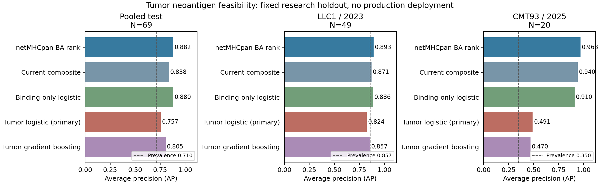

# 腫瘤 neoantigen 模型訓練可行性：2026-10-10

**已完成情境清理、固定跨研究測試集、模型訓練及一次性測試評估。新模型沒有
優於現有強基準，因此保留為研究紀錄，暫不替換正式系統。**

本輪依使用者選擇，限於老鼠腫瘤 neoantigen。感染抗原未混入訓練集。
目標是「接種腫瘤突變抗原後，對突變胜肽可偵測的 IFN-γ 反應」，不直接預測
未治療腫瘤的內源性辨識、自然呈現、腫瘤消退或疫苗治療效果。

## 實驗情境與標籤清理

使用既有 IEDB 原始快照，另取得 313 筆候選腫瘤 assay 的完整 `tcell_export`
紀錄，閱讀原始研究並核對補充表；本輪正式納入四個經確認的研究。

這次發現重要問題：IEDB epitope 摘要所列的 sequence 不一定是 assay 真正測試
的 antigen。例如 2025 年研究的 7 筆 Negative 記錄，實際測試的是 wild-type
對照；突變胜肽的結果則為 Positive。不能把這些 negative 貼到 mutant 上，
也不應把它們當成 mutant 的矛盾標籤。

新流程明確要求 **`assay_antigen__name == mutant peptide`**，並保留可驗證的
單一胺基酸替換 WT 配對。另排除未接種、僅帶瘤、接種後再經 tumor challenge、
adoptive transfer、特定 TCR 情境，以及非功能性 IFN-γ assay。
不同疫苗配方仍分別標記，不將配方／研究 ID 當成模型輸入。

四個研究的 225 筆候選紀錄中，182 筆符合條件；其餘排除：14 筆非 IFN-γ
assay、7 筆 WT／其他 assay antigen、7 筆第二次體內處置、7 筆非突變序列
priming、4 筆未接種、4 筆沒有符合此版要求的單一替換 WT 配對。
在此已清理的情境內沒有殘留陽性／陰性衝突，無需投票決定標籤。

這也表示前一輪摘要資料得到的 247 組「衝突」不全是生物學上的矛盾。
前一輪廣泛基準結果沒有在此重新計算，不用於本輪訓練決策；相關更正見
[前次基準資料限制說明](ERRATUM_PRIOR_BENCHMARK.md)。

## 訓練前鎖定資料

| 用途 | 研究 | 腫瘤來源 | N | 陽性／陰性 |
|---|---|---|---:|---:|
| 訓練 | Smith 2019，PMID 31515258 | B16F10、BBN963、MB49、UPPL1541 | 100 | 73／27 |
| 驗證診斷 | Li 2021，PMID 33879241 | E0771 | 10 | 3／7 |
| 測試 A | Fritah 2023，PMID 36950115 | LLC1 | 49 | 42／7 |
| 測試 B | 2025，PMID 40586324 | CMT93 | 20 | 7／13 |

訓練來源的 Kb/Db 配對由 [Smith 補充資料](https://aacr.figshare.com/articles/dataset/22542117)
確認 mutant、WT 及腫瘤株；P815 的 minor histocompatibility antigens、T11
及 class II 沒有納入。驗證來源的 E0771 突變由 [2021 研究](https://pmc.ncbi.nlm.nih.gov/articles/PMC8059244/)
及補充 Table S2 支持。兩個測試來源分別為 [LLC1 研究](https://pmc.ncbi.nlm.nih.gov/articles/PMC10025090/)
及 [CMT93 研究](https://pmc.ncbi.nlm.nih.gov/articles/PMC12462951/)。

在資料隔離時，先完整保留測試研究，再從開發資料移除與測試重疊的來源蛋白、
mutant／WT 序列，或正規化 edit distance ≤0.20 的近似序列；訓練與驗證也做
相同隔離。共從驗證資料移除 3 組，訓練資料沒有額外因跨分割重疊而移除。
訓練來源另有 2 筆在前面的 WT 配對檢查階段排除。記錄於 `locked/purged.csv`
與 `locked/assay_curation.csv`。

三個分割間的研究、腫瘤細胞株，以及已檢查的序列／來源蛋白重疊皆為 0。
固定清單及 SHA-256 在 `locked/split_lock.json`；時間順序已查核為
**split lock → fitted model checkpoint → test evaluation**。

這裡的「獨立」是指不參與本次新模型訓練，且採跨研究／腫瘤株隔離。
部分資料已出現在先前基準探索中，標籤也必須在清理時閱讀；因此不宣稱是
從未看過的前瞻性測試。來源蛋白 ID 也不能保證隔離所有蛋白家族同源性。

## 模型與特徵

固定 seed 20261010，未進行 hyperparameter search，未根據測試結果選模型。
StandardScaler 僅在訓練資料擬合；驗證集只做診斷，沒有併入訓練。

- Binding-only logistic regression：mutant EL／BA rank、affinity、長度及 allele。
- **事前指定主模型**：上述特徵加上 WT 與 mutant 的預測差、疏水／芳香族比例、
  帶電比例、proline 比例、突變位置及突變造成的疏水性指標變化，共 13 個特徵。
- 探索性 gradient boosting：使用相同 13 個特徵與固定參數。

基準包括現有 Calis、netMHCpan EL／BA rank、平台 base 與 composite。
沒有加入實驗 binding、原論文 ELISpot score、原論文 GBM prediction，或研究 ID。
此處的序列描述量不是 entropy 或 ΔG；模型輸出亦不是已校準的活化機率。

## 固定測試結果

測試共 69 組配對、49 陽性，陽性比例 **71.01%**。AP 為 average precision，
必須與各自資料集的陽性比例一起解讀，不能和前一輪感染為主的 AP 直接比較。

| 方法 | AP ↑ | ROC-AUC ↑ | 前 10 名陽性比例 ↑ |
|---|---:|---:|---:|
| netMHCpan BA rank | **0.882** | 0.763 | 90% |
| Binding-only logistic | 0.880 | 0.768 | 90% |
| 現有 Calis | 0.858 | 0.670 | 100% |
| 現行 composite | 0.838 | 0.669 | 90% |
| 平台 base | 0.837 | 0.659 | 90% |
| 探索性 gradient boosting | 0.805 | 0.604 | 90% |
| **腫瘤 logistic 主模型** | **0.757** | **0.622** | **60%** |

更重要的是研究內比較：

| 測試研究 | 陽性比例 | BA rank AP | Binding logistic AP | 主模型 AP | Gradient boosting AP |
|---|---:|---:|---:|---:|---:|
| LLC1，N=49 | 85.71% | 0.893 | 0.886 | 0.824 | 0.857 |
| CMT93，N=20 | 35.00% | 0.968 | 0.910 | 0.491 | 0.470 |

主模型在兩個研究的 AP 點估計都低於 BA baseline。尤其 LLC1 本身陽性比例很高，
AP 接近 0.9 不能單獨解讀成辨識力很好；主模型在此的 ROC-AUC 為 0.446。
CMT93 的 BA 表現雖高，樣本僅 20 組，同樣不能推廣到其他腫瘤。

主模型與 BA 的 pooled AP 差 **−0.1248**，以固定研究內的序列／蛋白群組做
1,000 次 paired bootstrap，其探索性 95% 區間為 **[−0.2199, −0.0181]**。
主模型與平台 base 的差則為 −0.0806，區間 **[−0.1879, +0.0413]**。
這些區間只描述固定研究內候選抽樣的不確定性，不能表示跨新研究／新實驗室的
信賴範圍。完整結果在 `run/uncertainty.json`。

驗證集僅 10 組：主模型 AP 0.756、binding logistic AP 0.756、base AP 0.806。
訓練內另完成按腫瘤株留一的診斷，UPPL1541 只有 2 組且皆陰性，該 fold 的
AP／AUC 標為無法估計。未將訓練資料上的擬合成績當作泛化表現。

## 可行性決策

**技術流程可行，但這版資料及特徵尚不足以支持新模型取代現有排序。**

主要限制是只有一篇研究供訓練、負例僅 27 組，且不同研究採用 peptide、DNA／SLP、
BMDC 等不同 vaccination setting。加入生物學上合理的特徵，不保證在小樣本與
情境轉移下改善預測；本次不能據此宣稱序列或突變特徵普遍無效。

下一階段應優先增加**有逐一測試陰性、WT 配對及實驗情境註解的獨立老鼠腫瘤
接種研究**，而不是立刻擴大模型或添加 entropy。應補足不同腫瘤株、Kb／Db
及多個實驗室，並事先規劃新的保留研究。此次測試集已完成評估，未來若用它
開發特徵，就必須將它視為開發資料，不能再稱為未使用測試集。

## 交付與驗證

已保存情境排除表、突變／WT 配對、固定資料分割、資料／程式校驗碼、348 條
mutant／WT 序列的 Kb/Db 預測、3 個研究模型、逐筆模型分數、研究內與 pooled
指標、bootstrap、圖表及 model card。

自動測試檢查 WT 陰性、未接種與 tumor challenge 的排除，近似序列／來源蛋白
隔離、詳細欄位身分一致性、標籤不進入特徵，以及 scaler 僅使用訓練資料。
另重載模型核對全部 179 組配對的預測，查核鎖定／訓練／評估時間順序與校驗碼。
8 項自動測試全部通過。正式系統未修改，沒有部署或新增正式模型選項。
