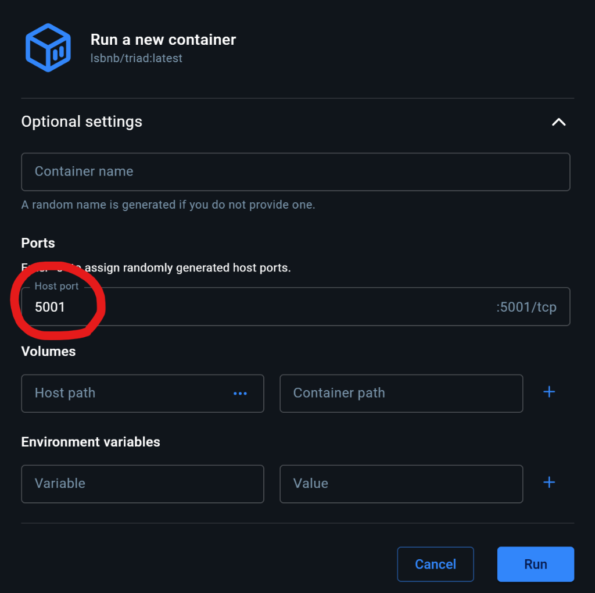

# TRIAD Framework — User Guide & API Documentation

**TRIAD: T-Cell Epitope Ranking, Immunogenicity, and Allele Distribution Framework**  
*Integrated High-Throughput MHC Class I Antigen Presentation, Physicochemical T-Cell Immunogenicity Scoring, and Global Population Coverage Architecture.*  
*Developed by Laboratory of Structural Bioinformatics and Network Biology (LSBNB), Institute of Information Science, Academia Sinica, Taiwan.*

---

## Table of Contents
1. [Overview & Architecture](#overview--architecture)
2. [NetMHCpan Setup & Academic Licensing Guide](#netmhcpan-setup--academic-licensing-guide)
3. [Input Formats & Specifications](#input-formats--specifications)
4. [HLA Allele Selection & Population Presets](#hla-allele-selection--population-presets)
5. [Output Metrics & Interpretation Guide](#output-metrics--interpretation-guide)
6. [Batch Multi-File Parallel Engine](#batch-multi-file-parallel-engine)
6b. [Multi-Epitope Vaccine Design & Preclinical Mouse Suite (v2.0)](#6b-multi-epitope-vaccine-design--preclinical-mouse-suite-v20)
7. [REST API & Command-Line Automation](#rest-api--command-line-automation)
8. [Hardware Acceleration & In-Memory RAM Disk](#hardware-acceleration--in-memory-ram-disk)
9. [Frequently Asked Questions (FAQ)](#frequently-asked-questions-faq)
10. [Citations & Scientific References](#citations--scientific-references)

---

## 1. Overview & Architecture

TRIAD integrates three complementary computational dimensions to rank and prioritize CD8+ cytotoxic T-cell epitopes for vaccine design, immunotherapy, and neoantigen discovery:

1. **MHC-I Antigen Presentation Model** (Reynisson et al., 2020):
   Predicts presentation probability (`%Rank EL`) and quantitative binding affinity (`Affinity_nM` / IC50) using artificial neural networks trained on over 1 million mass spectrometry eluted ligands (MS-EL) and experimental binding affinity (BA) measurements.
2. **Physicochemical T-Cell Immunogenicity Model** (Calis et al., 2013):
   Scores the intrinsic capability of MHC-bound peptides to trigger TCR (T-cell receptor) activation based on position-weighted amino acid physicochemical properties (aromaticity, large hydrophobicity, side-chain bulkiness at TCR-facing positions 4, 5, 6, 7, and 8).
3. **Cumulative Population Coverage Estimation**:
   Computes non-redundant human population coverage (%) across 22 selectable populations — Taiwan island-wide plus each of its Han and Indigenous groups, East Asia, Europe and World — derived from the Allele Frequency Net Database (AFND). See [Frequency-table provenance](#frequency-table-provenance).
4. **Composite Priority Score (CPS)**:
   A multi-objective candidate prioritization function balancing presentation likelihood, T-cell immunogenicity, and allele breadth.

---

## 2. NetMHCpan Setup & Academic Licensing Guide

### Academic License Notice
`netMHCpan-4.2` is academic-licensed software copyrighted by DTU Health Tech (Technical University of Denmark). Its license terms strictly prohibit redistribution of the binary and model weights to third parties (`"not give the program to third parties"`).

For legal compliance, the official Docker container (`lsbnb/triad`) ships as a clean application shell **without** the pre-bundled DTU binary. Each user must obtain their own copy under their own license acceptance.

### Step 1: Request & Download Package from DTU
1. Visit the [official DTU Health Tech Download Portal](https://services.healthtech.dtu.dk/services/NetMHCpan-4.2/).
2. Submit your academic institution email, accept the academic license terms, and download the Linux tarball (named `netMHCpan-4.2.Linux.tar.gz`).

### Step 2: Configure the Container (Choose Option A, Option B, or Option C)

#### Option A: Docker Volume Mount (Recommended for Servers / CLI)
Extract the downloaded package on your host machine and mount it directly into `/opt/netMHCpan-4.2`:
```bash
# 1. Extract package on host
tar -xzvf netMHCpan-4.2.Linux.tar.gz

# 2. Run TRIAD container with volume mount
docker run -d --name triad_app \
  -p 5001:5001 \
  -v /dev/shm:/dev/shm \
  -v "$(pwd)/netMHCpan-4.2:/opt/netMHCpan-4.2" \
  lsbnb/triad:latest
```

#### Option B: Docker Desktop GUI Setup (Windows / Mac Desktop Users)
> ⚠️ **Important Port Mapping Notice:**  
> When running the container via **Docker Desktop GUI**, expand **Optional Settings** before clicking *Run* and specify:
> - **Host Port**: `5001`
> - **Container Port**: `5001`
> 
> Without configuring `5001:5001` in Optional Settings, Docker Desktop will not forward web traffic and `http://localhost:5001` will not load.



#### Option C: Built-in Web Setup Wizard (No Terminal Required)
If you prefer not to touch the host terminal:
1. Start the container mapping port `5001:5001`:
   ```bash
   docker run -d --name triad_app -p 5001:5001 lsbnb/triad:latest
   ```
2. Open your web browser to `http://localhost:5001/setup`.
3. Select your downloaded `netMHCpan-4.2.Linux.tar.gz` package.
4. Check the academic license compliance confirmation checkbox and click **Upload & Install**.
5. The platform will automatically unpack, configure execution permissions, verify binary integrity, and redirect you directly to the prediction pipeline.

---

## 3. Input Formats & Specifications

TRIAD supports two primary input modes:

### Mode A: Peptide List Mode (`.pep`, `.txt`, or direct text)
- **Format**: Plain text with one peptide sequence per line.
- **Length**: **8 to 14 amino acids** (canonical MHC Class I binding length; 9-mer and 10-mer recommended).
- **Alphabet**: Standard 20 single-letter IUPAC natural amino acid codes (`A`, `C`, `D`, `E`, `F`, `G`, `H`, `I`, `K`, `L`, `M`, `N`, `P`, `Q`, `R`, `S`, `T`, `V`, `W`, `Y`).
- **Comments**: Lines starting with `#` or empty lines are automatically skipped.

**Example Peptide Input:**
```text
AAAWYLWEV
AEFGPWQTV
YLLPAIVHI
FLPSDFFPSV
GILGFVFTL
```

### Mode B: FASTA Protein Sequence Mode (`.fasta`, `.fsa`, `.fa`)
- **Format**: Standard FASTA format with header line beginning with `>` followed by the full-length or partial protein sequence.
- **Sliding Window Ingestion**: The system digests the input sequence into all overlapping k-mers based on specified peptide lengths (e.g., `8,9,10`).
- **Multi-FASTA**: You may submit multiple protein records sequentially.

**Example FASTA Input:**
```text
>sp|P0DTC2|SPIKE_SARS2 Spike protein fragment
MFVFLVLLPLVSSQCVNLTTRTQLPPAYTNSFTRGVYYPDKVFRSSVLHSTQDLFLPFFSNVTWFHAIH
VSGTNGTKRFDNPVLPFNDGVYFASTEKSNIIRGWIFGTTLDSKTQSLLIVNNATNVVIKVCEFQFCND
PFLGVYYHKNNKSWMESEFRVYSSANNCTFEYVSQPFLMDLEGKQGNFKNLREFVFKNIDGYFKIYSKH
```

---

## 4. HLA Allele Selection & Population Presets

### Allele Nomenclature
Alleles must adhere to standard IPD-IMGT/HLA nomenclature:
- Class I canonical format: `HLA-A*02:01`, `HLA-B*07:02`, `HLA-C*07:02`
- Legacy / compact format automatically normalized: `HLA-A02:01` or `A*02:01` -> `HLA-A*02:01`

### Built-in Regional Presets
Click any of the preset chips on the UI to load verified high-frequency allele combinations:
- **🇹🇼 Taiwan Common**: High-frequency Han Taiwanese HLA markers — `HLA-A*11:01` (allele frequency 0.291), `A*24:02` (0.178), `A*02:07` (0.109), `A*33:03` (0.106), `B*40:01` (0.217), `B*58:01` (0.099), `C*07:02` (0.203). For a specific Taiwanese community, set the target population in **Vaccine Design Target** instead — Hakka, Amis, Paiwan and the other groups each have their own table.
- **🌏 East Asian**: Predominant alleles in East Asian cohorts (`HLA-A*24:02`, `A*02:01`, `A*11:01`, `B*46:01`, `B*40:01`, `C*01:02`).
- **🌍 European**: Western European reference alleles (`HLA-A*02:01`, `A*01:01`, `A*03:01`, `B*07:02`, `B*08:01`, `C*07:01`).
- **🌐 World Reference Set**: 12 global representative alleles providing >90% worldwide population coverage.

### Custom HLA File Upload
Upload custom HLA lists (`.txt`, `.csv`, `.tsv`) with one allele per line or comma/tab-separated.

---

## 5. Output Metrics & Interpretation Guide

| Column Name | Metric | Interpretation & Decision Thresholds |
| :--- | :--- | :--- |
| **`Score_EL`** | Eluted Ligand Presentation Score | Range `[0.0, 1.0]`. Raw neural network probability that the peptide is naturally presented on the cell surface. |
| **`%Rank_EL`** | Presentation Percentile Rank | **Key Metric for Epitope Selection**.<br>• **$\le 0.5\%$**: **Strong Binder (SB)** — Highest confidence of natural presentation.<br>• **$0.5\% < \text{Rank} \le 2.0\%$**: **Weak Binder (WB)** — Potential presentation.<br>• **$> 2.0\%$**: Non-binder. |
| **`Affinity_nM`** | Predicted Binding Affinity (IC50) | Estimated half-maximal inhibitory concentration in nanomolar (nM):<br>• **$< 50\text{ nM}$**: High affinity.<br>• **$50 - 500\text{ nM}$**: Moderate affinity (standard immunogenicity cutoff).<br>• **$> 500\text{ nM}$**: Low/no affinity. |
| **`Immunogenicity_Score`** | Physicochemical T-Cell Score | Calis et al. (2013) log-odds activation score:<br>• **$> 0.0$**: Positive T-cell receptor recognition propensity.<br>• **$< 0.0$**: Low immunogenicity likelihood (often due to non-bulky or hydrophilic residues at TCR-facing positions). |
| **`BindLevel`** | Binder Classification | `SB` (Strong Binder), `WB` (Weak Binder), or empty (Non-binder). |
| **`Composite_Score`** | Multi-Factor Composed Index | Range `[0.0000, 1.0000]`. Golden candidate score synthesizing 4 dimensions:<br>• **40% Presentation** ($S_{\text{pres}}$ via %Rank_EL)<br>• **25% Binding Affinity** ($S_{\text{aff}}$ via IC50)<br>• **25% TCR Immunogenicity** ($S_{\text{imm}}$ via Calis model)<br>• **10% HLA Breadth** ($S_{\text{breadth}}$ cross-allele promiscuity). Higher is better. |
| **`Tier`** | Decision Priority Tier | • **`Tier 1`**: %Rank_EL $\le 0.5\%$ + Immunogenicity $>0$ + Composite $\ge 0.65$ (Top priority for experimental validation).<br>• **`Tier 2`**: %Rank_EL $\le 2.0\%$ + Composite $\ge 0.45$ (Secondary candidates).<br>• **`Tier 3`**: Weak/non-binders or lacking TCR features (Low priority/controls). |

---

## 6. Batch Multi-File Parallel Engine

For large-scale processing of proteomes, viral variants, or patient cohort libraries:
1. Navigate to the **📦 Batch Engine** tab.
2. Drag and drop multiple `.fasta`, `.fsa`, `.pep`, or `.txt` files simultaneously into the drop zone.
3. Select desired HLA alleles or click a regional preset.
4. Click **▶ Run Batch Processing Pipeline**.
5. The scheduler distributes sequence chunks evenly across up to 40 CPU cores in parallel, utilizing RAM disk (`/dev/shm`) for zero-disk-latency temporary I/O.
6. Upon completion, click **⬇ Download Batch CSV** to export consolidated multi-file reports.

---

## 6b. Multi-Epitope Vaccine Design & Preclinical Mouse Suite (v2.0)

Prediction ranks peptides one at a time. A vaccine is a **set**, and the question that decides its
design is how much of a population the set reaches *together*. This section covers the set-level
and construct engineering workflow in v2.0.

### Why the old coverage number was not enough

Up to v1.1 the results page showed the coverage of the **allele panel** you typed into the search box.
That figure is fixed the moment you submit and does not move when the predictions come back — a job
in which nothing bound still displayed ~95%. v1.2 keeps it (clearly labelled) but promotes a second
figure to the headline:

| Figure | Meaning | Moves when… |
| :--- | :--- | :--- |
| **Panel coverage** | Share of people carrying at least one allele you selected. | You change the allele panel. |
| **Reachable coverage** | Share of people presenting at least one peptide the job returned as a binder. The ceiling any vaccine from this job can reach. | The predictions change. |
| **Set coverage** | Share of people presenting at least one peptide *you have ticked*. | Every checkbox click. |

### Step 1 — State the design target

In **🔬 Predict Pipeline → 💉 Vaccine Design Target**:

- **Target population** — Taiwan, East Asia, World or Europe (see *Frequency-table provenance* below).
- **Coverage goal** — the share of that population that must present at least one vaccine epitope.
- **Redundancy** — whether you require ≥1 or ≥2 epitopes per person.
- **🤖 Auto-build panel** — picks the smallest set of high-frequency alleles reaching the goal, so you
  never have to guess how many alleles to select.

### Step 2 — Build the epitope set

Run the prediction, then in **📊 Results** tick peptides in the leftmost column. The **💉 Epitope Set**
panel beside the table updates on every click with:

- **≥ 1 epitope per person** — headline set coverage, with a marker at your goal.
- **≥ 2 epitopes (redundancy)** — the share of people who would still respond if one epitope were lost.
  A set whose ≥2 figure sits far below its ≥1 figure is fragile regardless of the headline number.
- **Not reached** — panel alleles the set never presents to, ranked by frequency.
- **Best next pick** — the single peptide with the highest marginal gain, with a one-click Add.

Useful controls: **ΔCov** column (sortable) shows what each peptide would add *on top of* the current
set — a Tier 1 peptide restricted to an allele you already cover scores ~0, while a Tier 2 peptide on
an untouched allele can be worth several points. **🤖 Auto-complete to goal** fills the set greedily,
breaking ties by Composite Score.

### Step 3 — Assemble and audit the construct

**💉 Vaccine Designer** turns the set into a string-of-beads immunogen:

- **Linkers** — `AAY` (proteasome cleavage, class I), `KK` (cathepsin B), `GPGPG` (class II / HTL,
  suppresses junctional epitopes), `EAAAK` (rigid domain spacer), or none.
- **Terminal modules** — start Met, His6, TAT cell-penetrating peptide, PADRE universal helper epitope.
- **Order** — drag rows to reorder; the sequence and every downstream number update immediately.
- **Properties** — length, mass, GRAVY hydropathy (Kyte–Doolittle), predicted pI (EMBOSS pKa set).
- **Exports** — FASTA, back-translated DNA (most-frequent human codon per residue — a synthesis
  starting point, *not* a finished optimisation), and a CSV design report.

**⚠️ Junctional Epitope Scan** is the quality gate. Joining epitopes creates sequence present in
neither the pathogen nor the host; if such a window is itself presented it competes with your designed
epitopes for the same MHC molecules and can drive off-target responses. The scan folds the construct
back through netMHCpan-4.2 and flags every presented window that is **not** one of your epitopes,
naming the join that produced it. Reorder the epitopes or switch to GPGPG and re-scan.

### The coverage model

Individuals are drawn under Hardy–Weinberg equilibrium with the HLA-A / B / C loci independent.
Writing `P₀(T)` for the probability an individual carries none of the alleles in `T`:

```text
P₀(T)   = ∏ over loci L of ( 1 − Σ f(a) for a ∈ T at locus L )²

≥1 hit  = 1 − P₀(R)                             R   = alleles presenting ≥1 chosen peptide
≥2 hits = 1 − P₀(R) − Σ_e [ P₀(B_e) − P₀(R) ]   B_e = alleles presenting some peptide ≠ e
```

Both are computed exactly rather than by simulation, so they update instantly and do not jitter
between clicks. The browser mirrors this formula for interactivity but fetches the frequency data from
`/api/coverage/freq_table`, keeping `population_coverage.py` the single source of truth.

### Frequency-table provenance

Every value in the 22 population tables is regenerated from a single public input by
`tools/build_afnd_tables.py`, so the numbers are auditable rather than hand-entered:

```bash
python3 tools/build_afnd_tables.py --verify        # re-derive and diff against the shipped tables
python3 tools/build_afnd_tables.py --legacy-delta  # show how much the v1.2 fixes moved v1.1's tables
python3 tools/build_afnd_tables.py --emit --json --out data/allele_frequencies.json
```

**Source.** `afnd.tsv` from the community mirror [slowkow/allelefrequencies](https://github.com/slowkow/allelefrequencies)
(MIT; license bundled in `THIRD_PARTY_LICENSES/`), derived from the Allele Frequency Net Database
(Gonzalez-Galarza FF *et al.*, *Nucleic Acids Res* 2020;48:D783–D788, CC BY 4.0).
**Method.** 2-field HLA-A/B/C records, `alleles_over_2n` averaged by reported sample size *n*, top 18
alleles kept per population. The tables live in `data/allele_frequencies.json`.

### Taiwan is not one population

Its component groups differ far too much to share a table, so **each is selectable in its own right**:

| Selectable population | AFND entries | *n* |
| :--- | :--- | ---: |
| 🇹🇼 **Taiwan (island-wide)** | Han and recognised Indigenous tables combined at **97.5% / 2.5%** population shares | 2,640 |
| Han 漢人 (all) | Tzu Chi Cord Blood Bank, Han Chinese, pop 2, pop 3, Minnan, Hakka | 1,947 |
| └ Minnan / Hoklo 閩南 | `Taiwan Minnan pop 1` | 102 |
| └ Hakka 客家 | `Taiwan Hakka` | 55 ⚠ |
| Indigenous 原住民族 (all) | The 11 nationally recognised peoples | 693 |
| └ Amis 阿美族 · Atayal 泰雅族 · Bunun 布農族 · Paiwan 排灣族 · Puyuma 卑南族 · Rukai 魯凱族 · Saisiyat 賽夏族 · Tao 達悟族 · Truku 太魯閣族 · Thao 邵族 · Tsou 鄒族 | one AFND entry each | 30–106 ⚠ |
| Pingpu 平埔族 (all) | Pazeh, Siraya — in neither aggregate | 106 ⚠ |

⚠ = fewer than 100 individuals; the UI warns before you design against these.

How different are they? Enough that an island-wide average is the wrong tool for a targeted design:

| Allele | Minnan | Hakka | Amis | Paiwan | Saisiyat | Tao |
| :--- | ---: | ---: | ---: | ---: | ---: | ---: |
| `HLA-A*11:01` | 0.309 | **0.400** | 0.010 | 0.000 | 0.000 | 0.000 |
| `HLA-A*24:02` | 0.309 | 0.282 | 0.628 | **0.863** | 0.569 | 0.540 |
| `HLA-C*07:02` | 0.206 | 0.227 | 0.163 | 0.020 | **0.667** | 0.010 |
| `HLA-B*39:01` | 0.005 | 0.000 | 0.010 | 0.000 | **0.549** | 0.000 |
| `HLA-B*15:25` | 0.000 | 0.000 | 0.000 | 0.000 | 0.000 | **0.400** |

**Why the island-wide table is blended, not pooled.** AFND holds 11 recognised Indigenous entries
(*n* = 693) against 6 Han-representative ones (*n* = 1,947), so averaging by sample size alone would hand
Indigenous peoples **26%** of the table — against roughly **2.5%** of the population (~580,000 of
23.4 million, Ministry of the Interior). `A*24:02` runs at 0.633 in the Indigenous entries versus 0.167 in
the Han ones, so a pooled average would report it at **0.2892** instead of 0.1785, overstating every
A\*24:02-restricted epitope by 62%. The blend combines the two group tables at their demographic shares;
allele frequencies are additive across subpopulations weighted by population share, so this is the correct
combination, not an approximation.

Plains Indigenous (Pazeh, Siraya) sit in **neither** aggregate: they are not nationally recognised
Indigenous peoples and are largely assimilated into the Han-identifying population, so folding them into
either bucket would misstate that bucket.

### Broader regions

| Region | AFND populations | *n* |
| :--- | :--- | ---: |
| 🌏 East Asia | China, Japan, Taiwan, Mongolia, Hong Kong. **Does not include Korea.** | 56,845 |
| 🌐 World | Every AFND population. Weighted by sample size, so the megaregistries (DKMS, NMDP) dominate — an average of the studies present, *not* a world census. | 7,026,383 |
| 🌍 Europe | 24 European countries. | 3,685,409 |

### Two data-quality corrections in v1.2

**1. Sample sizes with thousands separators were silently dropped.** AFND writes large cohorts as
`3,456,066`. Parsing `n` with a plain `float()` throws, and the record was skipped — 36.6% of HLA-A/B/C
rows and **99.0% of all sampled individuals**, including DKMS German donors (*n* = 3,456,066) and NMDP
European Caucasian (*n* = 1,242,890). v1.1's World and Europe tables were therefore built from the ~1% of
the data with *n* < 1,000. Run `--legacy-delta` to see the full effect; the headline moves:

| | v1.1 | v1.2 |
| :--- | ---: | ---: |
| World `A*02:01` | 0.1519 | **0.2393** |
| World `A*03:01` | 0.0545 | **0.1233** |
| Europe `A*02:01` | 0.2399 | **0.2834** |
| East Asia `A*11:01` | 0.2429 | **0.1868** |

Taiwan and every Taiwan subgroup are **unaffected** — no Taiwan population in AFND has *n* ≥ 1,000.

**2. A minimum-support filter.** With the parser fixed, one mis-entered record can dominate a pooled
region: AFND lists `C*01:57` at 0.1996 in a single 4,889-person NMDP cohort and nowhere else, which was
enough to push a genuinely rare allele into the World top-18. Pooled regions (World, East Asia, Europe)
now require an allele to be reported by **≥ 3 populations**. The curated Taiwan groups are exempt, because
there a single-population allele is usually the signal — Tao carry `B*15:25` at 0.400 and no other group
does.

Two further changes to the coverage **model** (as opposed to the data) also move the numbers:
alleles at the same locus are now summed before the Hardy–Weinberg square rather than multiplied as
independent events — a locus has only two slots, so v1.1's product form under-estimated coverage within
a locus; and alleles with no frequency record for the selected region now contribute 0 and are listed in
the UI, instead of silently receiving a fabricated 0.08. Panel coverage is therefore an explicit
**lower bound**, and mouse H-2 runs no longer report a meaningless "human population coverage".

**Vaccine design API** (see section 7 for the full list):

```bash
# Set coverage for chosen peptides
curl -X POST http://localhost:5001/api/set_coverage \
  -H "Content-Type: application/json" \
  -d '{"job_id":"<JOB_ID>","peptides":["FLPSDFFPSV","QVPLRPMTYK"],"region":"East Asia","all_regions":true}'

# Greedy completion to a coverage goal
curl -X POST http://localhost:5001/api/optimize_set \
  -H "Content-Type: application/json" \
  -d '{"job_id":"<JOB_ID>","region":"East Asia","goal_pct":90}'

# Assemble and audit the construct
curl -X POST http://localhost:5001/api/construct/scan \
  -H "Content-Type: application/json" \
  -d '{"peptides":["FLPSDFFPSV","QVPLRPMTYK"],"alleles":["HLA-A02:01","HLA-A11:01"],"linker":"AAY"}'
```

---

## 7. REST API & Command-Line Automation

TRIAD exposes a standard REST API on port `5001`.

### Health & Hardware Status
```bash
curl -s http://localhost:5001/api/system_resources | jq .
```

### Submit Prediction Job
```bash
curl -s -X POST http://localhost:5001/api/predict \
  -H "Content-Type: application/json" \
  -d '{
    "mode": "peptide",
    "input": "AAAWYLWEV\nAEFGPWQTV\nYLLPAIVHI\nGILGFVFTL",
    "alleles": ["HLA-A*02:01", "HLA-B*07:02"],
    "lengths": [9],
    "include_ba": true
  }'
```
**Response:**
```json
{
  "job_id": "c4d7e821",
  "status": "running"
}
```

### Poll Job Status & Retrieve Results
```bash
curl -s http://localhost:5001/api/job/c4d7e821 | jq .
```

### Download CSV / Excel Report
```bash
# Download CSV
curl -O http://localhost:5001/api/download/c4d7e821/csv

# Download Excel Spreadsheet
curl -O http://localhost:5001/api/download/c4d7e821/xlsx
```

### Orthogonal Matrix Cross-Validation (SMM / Comblib)
```bash
curl -s -X POST http://localhost:5001/api/predict_oss \
  -H "Content-Type: application/json" \
  -d '{
    "peptides": ["GILGFVFTL", "YLLPAIVHI"],
    "allele": "HLA-A*02:01",
    "methods": ["smm", "smmpmbec", "comblib"]
  }' | jq .
```

### Vaccine Design Endpoints (v2.0)

All set-level endpoints accept the binder matrix in any of three forms: `job_id` (server reads the
stored job), `rows` (raw prediction records), or `binder_map` (`{peptide: [alleles]}` directly).
Add `peptides` to restrict a job to a chosen subset, and `rank_cut` to change the binder threshold
(default `2.0`).

| Endpoint | Method | Purpose |
| :--- | :--- | :--- |
| `/api/coverage` | POST | Coverage of an allele **panel**. |
| `/api/coverage/regions` | GET | Regions with frequency data, aliases, top alleles per region. |
| `/api/coverage/freq_table` | GET | Raw allele-frequency tables (what the browser engine loads). |
| `/api/coverage/panel` | POST | Smallest allele panel reaching a coverage goal. |
| `/api/set_coverage` | POST | Coverage of an epitope **set** (≥1 and ≥2 hits, unreached alleles). |
| `/api/marginal_coverage` | POST | Percentage points each candidate would add to the current set. |
| `/api/optimize_set` | POST | Greedy completion of a set to a coverage goal. |
| `/api/construct/options` | GET | Available linkers and terminal modules with their rationale. |
| `/api/construct/build` | POST | Assemble a construct; returns sequence, segments, properties, FASTA, DNA. |
| `/api/construct/scan` | POST | Assemble **and** scan the joins for junctional epitopes. |
| `/api/construct/optimize_order` | POST | Permutation search to find epitope order minimizing junctional hits. |
| `/api/construct/designs` | GET/POST/DELETE | Persistent vaccine design archive storage, retrieval and deletion. |

```bash
# Coverage of a chosen epitope set, across every region at once
curl -s -X POST http://localhost:5001/api/set_coverage \
  -H "Content-Type: application/json" \
  -d '{
    "job_id": "c4d7e821",
    "peptides": ["FLPSDFFPSV", "QVPLRPMTYK"],
    "region": "East Asia",
    "panel": ["HLA-A*02:01", "HLA-A*11:01", "HLA-B*40:01"],
    "all_regions": true
  }' | jq '{coverage_pct, coverage2_pct, uncovered_alleles, by_region}'

# Fewest epitopes reaching 90% of East Asia
curl -s -X POST http://localhost:5001/api/optimize_set \
  -H "Content-Type: application/json" \
  -d '{"job_id": "c4d7e821", "region": "East Asia", "goal_pct": 90}' \
  | jq '{peptides, coverage_pct, goal_met, trace}'

# Assemble and audit the joins
curl -s -X POST http://localhost:5001/api/construct/scan \
  -H "Content-Type: application/json" \
  -d '{
    "peptides": ["FLPSDFFPSV", "QVPLRPMTYK"],
    "alleles": ["HLA-A02:01", "HLA-A11:01"],
    "linker": "AAY", "n_term": "MET"
  }' | jq '{sequence, scan: {n_windows: .scan.n_windows, n_hits: .scan.n_hits, hits: .scan.hits}}'
```

---

## 8. Hardware Acceleration & In-Memory RAM Disk

TRIAD automatically profiles host resources at startup:
- **Parallel Chunking**: Calculates optimal CPU partition workers based on sequence length and CPU core count.
- **RAM Disk Accelerator (`/dev/shm`)**:
  All intermediate sequences, temporary neural network input pipes, and chunk outputs are written directly to memory (`/dev/shm/netmhc_tmp`). This avoids physical disk wear, eliminates file lock contention, and provides a 3–5x acceleration over standard disk storage.
- **Automatic Cleanup**: Temporary directories are rigorously unlinked and freed after every worker execution.

---

## 9. Frequently Asked Questions (FAQ)

#### Q1: Why are my sequences rejected with "invalid length"?
**Answer:** MHC Class I peptide binding grooves are closed at both the N- and C-termini, restricting canonical binding to **8–14 amino acids**. If you have a full protein sequence, ensure you switch to **FASTA Format** so the engine can automatically digest the protein into 8–14 aa k-mers.

#### Q2: What is the difference between `%Rank EL` and `Affinity (IC50)`?
**Answer:** `%Rank EL` models natural antigen presentation (including intracellular processing, TAP transport, and stable cell-surface presentation). `Affinity_nM` measures pure in vitro biochemical binding stability. Peptides with low `%Rank EL` ($\le 0.5\%$) have the highest likelihood of in vivo immunological relevance.

#### Q3: Can I run custom HLA combinations from patient genotyping?
**Answer:** Yes. Paste or search individual alleles in the search box, or upload a `.txt` file containing your patient's 4-digit HLA alleles under the Regional Presets section.

#### Q4: What if I need to reconfigure or verify my NetMHCpan installation?
**Answer:** Visit `http://localhost:5001/setup` at any time to verify installation status, view current paths, or upload an updated package.

---

## 10. Citations & Scientific References

If you use TRIAD in published scientific research, please cite:
1. **MHC Presentation Model**:  
   Reynisson B, Alvarez B, Paul S, Peters B, Nielsen M.  
   *NetMHCpan-4.1 and NetMHCIIpan-4.0: improved predictions of MHC antigen presentation by concurrent motif deconvolution and integration of MS eluted ligand data.*  
   **Nucleic Acids Res.** 2020;48(W1):W449-W454. [doi:10.1093/nar/gkaa379](https://doi.org/10.1093/nar/gkaa379)
2. **T-Cell Immunogenicity Model**:  
   Calis JJ, Maybeno M, Greenbaum JA, et al.  
   *Properties of MHC Class I Presented Peptides That Inspire Immunogenicity.*  
   **PLoS Comput Biol.** 2013;9(10):e1003266. [doi:10.1371/journal.pcbi.1003266](https://doi.org/10.1371/journal.pcbi.1003266)
3. **Population Coverage & Allele Frequencies**:  
   Gonzalez-Galarza FF, et al.  
   *Allele frequency net database (AFND) 2020 update: gold-standard data classification, open access genotype data and new query tools.*  
   **Nucleic Acids Res.** 2020;48(D1):D783-D788. [doi:10.1093/nar/gkz1029](https://doi.org/10.1093/nar/gkz1029)
4. **Platform & Computational Architecture**:  
   *Laboratory of Structural Bioinformatics and Network Biology (LSBNB), Institute of Information Science, Academia Sinica, Taiwan.*
